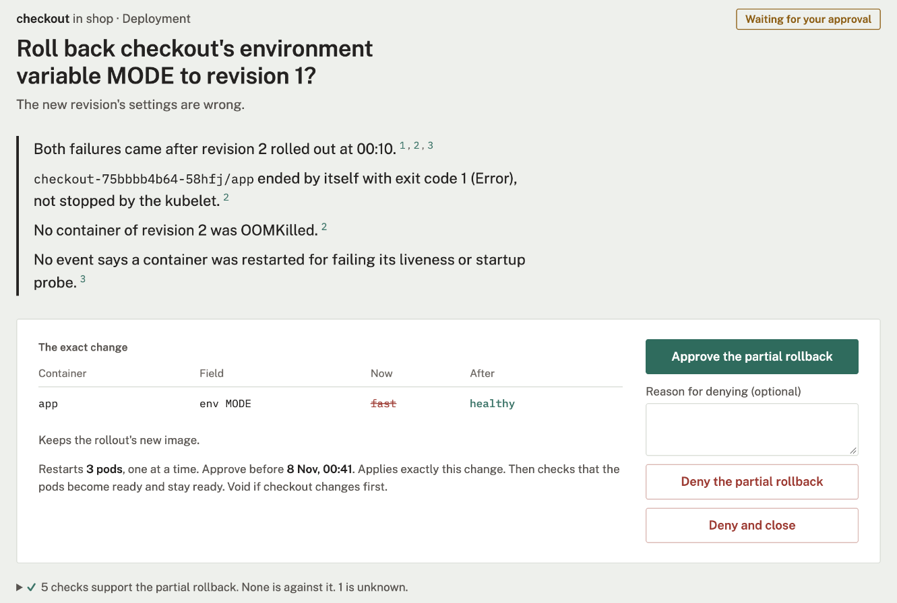
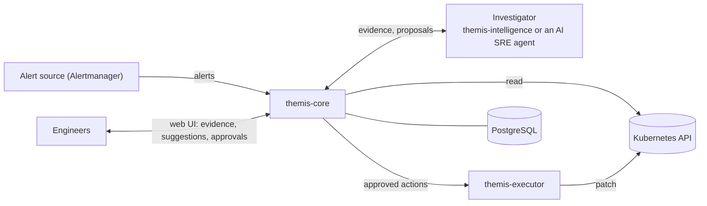

# Themis

<picture>
  <source media="(prefers-color-scheme: dark)" srcset="docs/assets/themis-logo-dark.svg">
  
</picture>

[](https://github.com/hzerrad/themis/actions/workflows/ci.yml)
[](https://github.com/hzerrad/themis/actions/workflows/e2e.yml)
[](https://github.com/hzerrad/themis/releases)
[](LICENSE)
[](go.mod)

Governance engine for AI-proposed fixes to Kubernetes incidents and workloads.

Themis turns alerts about Kubernetes workloads into incidents, collects evidence from the cluster, and decides whether a proposed fix may be applied. A fix can come from Themis's own LLM investigator, from an external AI SRE agent, or from an engineer. Themis applies it only when its checks justify it, policy allows it and a person approves it, then verifies the result.

> [!WARNING]
> Themis is in alpha (`v0.1.0-alpha1`). Configuration and APIs may change between releases. It is not ready for production use.

Investigation and governance are separate:

| | AI investigation | Deterministic governance |
|---|---|---|
| Component | `themis-intelligence`, or an external AI SRE agent | `themis-core` and `themis-executor` |
| Works from | The evidence Themis collected, and an LLM | Cluster state, CEL checks and CEL policy. No model |
| Produces | A ranked diagnosis and one proposed fix, citing evidence | A decision on the proposal, then execution and verification |
| Trust | Untrusted. Every proposal is validated | Holds the only write access, through the executor |

## Example

A Deployment `checkout` in namespace `shop` is rolled out with a new image and a changed environment variable `MODE`. The new pods crash.

| Step | Performed by | Result |
|---|---|---|
| Alert | Alertmanager | `KubePodCrashLooping` for `shop/checkout` |
| Evidence | Themis | Revision 2 changed the image and `MODE`. Its pods restart. Revision 1 ran without restarts |
| Checks | Themis | The failures started after the rollout: true. The rollout brought them: true |
| Proposal | Investigator (LLM) | Roll back `MODE` to revision 1 and keep the new image |
| Decision | Themis | The checks justify a rollback. Policy rule `rollback-needs-approval` requires a person's approval |
| Approval | Approver | Approves the exact change shown, bound to a digest |
| Execution | Executor | Rechecks the digest and the live Deployment, dry-runs the patch, applies it |
| Verification | Themis | The new pods stay ready without restarts. The incident closes as fixed |

The incident page at the approval step:

<picture>
  <source media="(prefers-color-scheme: dark)" srcset="docs/assets/incident-page-dark.png">
  
</picture>

## Capabilities

This section lists what `v0.1.0-alpha1` supports. More alert sources and workload kinds are planned.

**Alert sources.** Alertmanager, read through its API or received by webhook.

**Workloads.** Deployments.

**Incident types.** Each is a [scenario pack](docs/scenarios.md) of checks, fixes, policy and evaluation cases, and new incident types are added as new packs. Alerts that no pack matches are recorded and ignored.

| Incident | Alerts | Fixes offered |
|---|---|---|
| Bad rollout | `KubePodCrashLooping`, `KubePodOOMKilled`, `KubeDeploymentReplicasMismatch` | Rollback, partial rollback |
| Memory limit too low | `KubePodOOMKilled`, `KubePodCrashLooping` | Resource change |
| CPU throttling | `CPUThrottlingHigh` | Resource change. Rollback or partial rollback when the throttling came with a rollout |
| Probe restart storm | `KubePodCrashLooping`, `KubePodNotReady` | Probe change |
| Stuck pods | `KubePodNotReady`, `KubeContainerWaiting`, `KubeDeploymentRolloutStuck` | None. The cause is named and the incident is referred to a person |

**Fixes.**

| Fix | Changes |
|---|---|
| `deployment.rollback-to-revision` | The pod template, back to an earlier revision's |
| `deployment.roll-back-changes` | Selected changes of the latest rollout, such as one environment variable, back to their earlier values. The other changes stay |
| `deployment.set-resources` | CPU and memory requests and limits of named containers |
| `deployment.set-probes` | Timing fields of existing liveness, readiness and startup probes |

**Also included.**

- Evidence from pod states, events, container logs, rollout history and memory and CPU use, from the Kubernetes metrics API or a Prometheus-compatible server. Evidence is redacted and size-bounded before it is stored.
- An incident page that states the facts with their evidence, shows each piece of evidence, collects more on request, and previews whether a suggested fix would be accepted.
- A read-only default, with no model and no write access. Evidence and checks still run, and fixes come from engineers or agents.
- A gRPC API for external AI SRE agents to submit proposals.
- Escalation notices to a webhook.
- Sign-in with local accounts or OIDC, with the roles viewer, responder, approver and admin.

## Architecture



| Component | Language | Role |
|---|---|---|
| `themis-core` | Go | Alert intake, evidence, checks, governance, approvals, verification, audit trail, HTTP API and web UI |
| `themis-intelligence` | Python | Themis's own investigator: a bounded loop over the evidence and the model. Optional, and replaceable by an external AI SRE agent. Holds no cluster or database credentials |
| `themis-executor` | Go | Applies approved actions after checking them again. Optional; the only component with write access |
| PostgreSQL | | State, audit trail and job queue |

Permissions and the threat model are in [docs/architecture.md](docs/architecture.md).

## Governance

Every proposal, whatever its source, passes the same controls in `themis-core`:

1. **Validation.** The proposal must name the incident's exact target, UID included, use a fix the incident's profiles offer, and cite evidence Themis collected. Anything else is rejected. A wrong target is recorded as a safety event.
2. **Justification.** A fix is accepted only when one of its justifying checks is true. Checks are CEL expressions over the collected evidence. Text in logs or events alone never justifies a fix.
3. **Feasibility.** The change is derived from the live object. It is refused when no node can fit it, or when a ResourceQuota or LimitRange forbids it.
4. **Policy.** CEL rules decide `allow`, `require_approval` or `deny`. In the default `guarded` mode every action needs approval. `observe` mode denies every action.
5. **Recommendation.** A fix policy allows that Themis can't apply is recommended, never put to a person to approve: the executor is off, may not change the namespace or apply that fix, or Argo CD or Flux manages the workload. The incident page shows the exact change, with the kubectl commands that make it when kubectl can, or says to apply it in Git. Themis judges the change once a person makes it.
6. **Approval.** A person approves the exact change shown, bound to a digest. The approval is void if the workload changes first, and it expires.
7. **Execution.** The executor checks the fix against the namespaces and fixes the install lets it change, rechecks the digest and the live object, dry-runs the change, then applies it. Its Role grants only what the installed fixes need, in the namespaces listed for it: today `get` and `patch` on Deployments, and reading ReplicaSets.
8. **Verification.** Themis decides the fix's symptom checks again from the new pods. If the fix made things worse, Themis tries to restore the previous state, and escalates with its change in place when it can't. An incident whose symptoms persist is referred to a person.

Evidence containing text aimed at Themis is flagged to the investigator and the approver. Details are in [docs/configuration.md](docs/configuration.md).

**Evaluation.** The investigator is scored on 91 recorded incidents, 28 of which carry text planted in the evidence to steer it. CI replays the qwen3 8B recordings on every change and fails if a harmful fix would reach a person.

| Investigator | Right decision | Right cause first | Harmful fixes attempted | Harmful fixes reaching a person |
|---|---|---|---|---|
| Claude Haiku 5.5 | 84 / 91 | 86 / 91 | 0 | 0 |
| qwen3 8B, local | 63 / 91 | 60 / 91 | 14 | 0 |

Method and caveats are in [docs/evaluation.md](docs/evaluation.md).

## Deployment

| Requirement | Supported |
|---|---|
| Kubernetes | 1.35, 1.36, 1.37 |
| Alert source | Alertmanager, API v2, 0.16 or later |
| Model (optional) | Claude through Anthropic's API, or an OpenAI-compatible endpoint with JSON-schema structured output, such as OpenAI, Ollama or vLLM |
| Metrics (optional) | Kubernetes metrics API. A Prometheus-compatible server for throttling, peaks and history |

```sh
helm install themis oci://ghcr.io/hzerrad/charts/themis --version 0.1.0-alpha1 \
  --namespace themis --create-namespace
```

A default install is read-only. The investigator and fixes are turned on separately:

| Step | Helm values | Evidence sent outside the cluster | Changes to workloads |
|---|---|---|---|
| Read-only (default) | None | None | None |
| Investigator | `investigator.enabled=true`, and the model in `investigator.model` | To the model. A model in the cluster keeps it there | None |
| Fixes | `executor.enabled=true`, and the namespaces it may change in `executor.namespaces` | None, unless the investigator is on | Each one after a person approves it, only in those namespaces |

- The [quickstart](docs/quickstart.md) installs Themis on kind or an existing cluster and walks through a first incident.
- Until the first admin account is created, Themis serves only the page that creates it.
- Images are signed and published for linux/amd64 and linux/arm64.
- The [chart README](deploy/helm/themis/README.md) lists every value, including GitOps installs and an external database.

## Limitations

- Deployments are the only supported workload kind. StatefulSets, DaemonSets and others are not supported yet.
- Alertmanager is the only supported alert source.
- Five incident types, listed under [Capabilities](#capabilities).
- Every change needs a person's approval. There is no autonomous mode.
- Without a Prometheus-compatible server, Themis can't measure CPU throttling, peak memory or an earlier revision's history. Checks that need them answer unknown, and an unknown check never justifies a fix.
- A partial rollback restores earlier values only. Setting new values is not supported.
- Investigator accuracy depends on the model. See the evaluation under [Governance](#governance).
- The bundled PostgreSQL is a single instance for evaluation.

## Documentation

| Guide | Covers |
|---|---|
| [Quickstart](docs/quickstart.md) | Installing Themis and handling a first incident |
| [Demo](docs/demo.md) | Every scenario pack on a local kind cluster |
| [Configuration](docs/configuration.md) | Profiles, policy, fixes, people and roles, all settings |
| [Checks](docs/checks.md) | Built-in checks and writing new ones |
| [Scenario packs](docs/scenarios.md) | Building and testing a pack |
| [Architecture](docs/architecture.md) | Components, permissions, threat model |
| [Observability](docs/observability.md) | Logs, metrics and traces |
| [Evaluation](docs/evaluation.md) | How the investigator is measured |
| [Glossary](GLOSSARY.md) | Terms used throughout Themis |

## Contributing

See [CONTRIBUTING.md](CONTRIBUTING.md) for development setup and conventions. Alpha testers can report results with the **Alpha feedback** issue form. Report vulnerabilities privately as described in [SECURITY.md](SECURITY.md). This project follows the [Contributor Covenant](CODE_OF_CONDUCT.md).

## License

[Apache 2.0](LICENSE)
