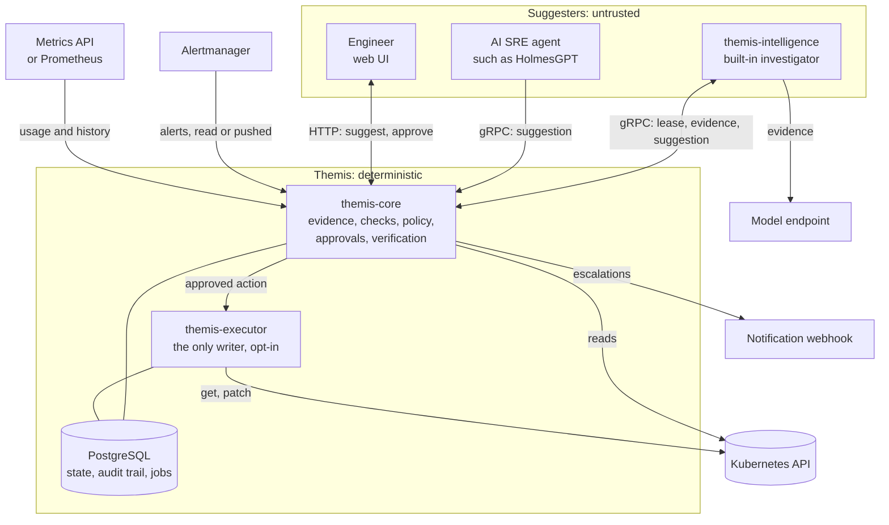
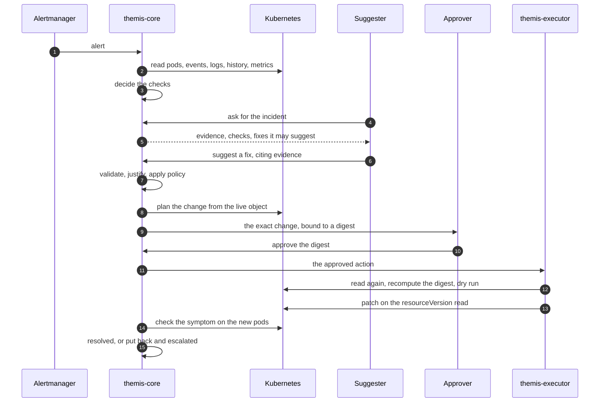
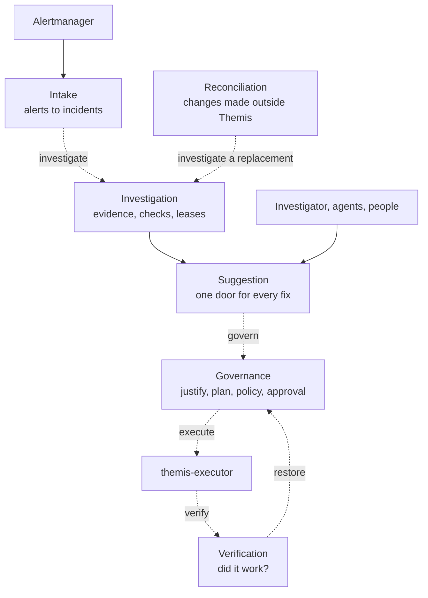
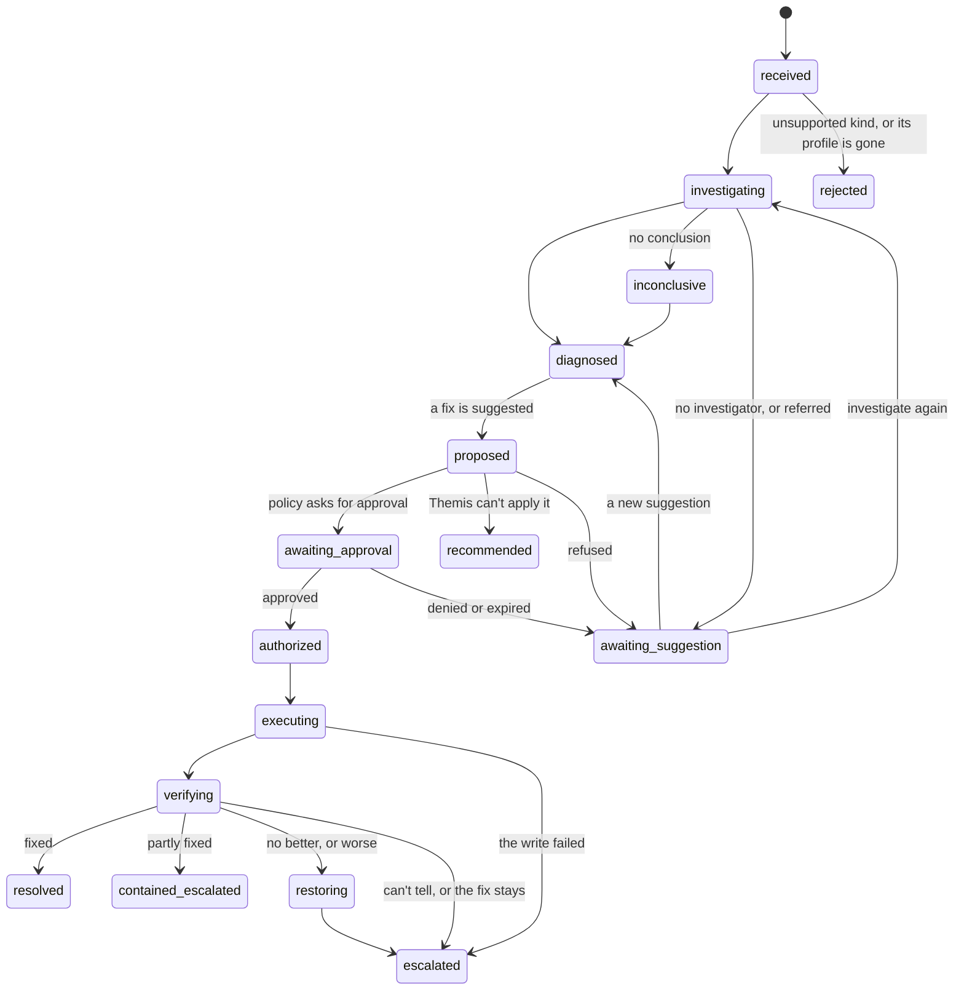
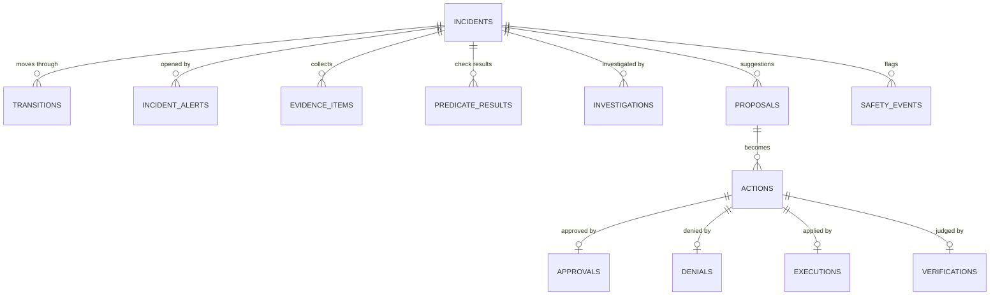
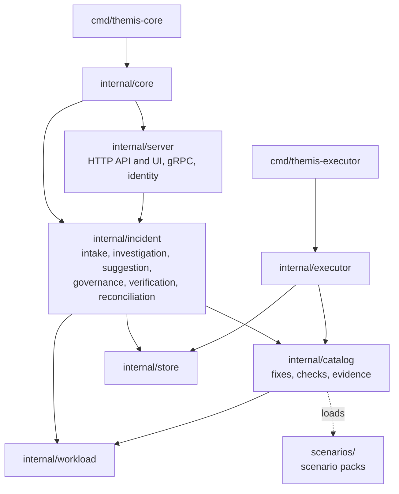

# Architecture

Themis separates who suggests a fix from who decides and applies it. Suggesters are untrusted and can be wrong or manipulated. The core decides from evidence it collects itself, with checks and policy written in CEL and no model. Only the executor writes to workloads, and only after a person approves the exact change.

## Components

| Component | Can | Cannot |
|---|---|---|
| `themis-core` | Read alerts, enrolled workloads, pods, logs, events and metrics; read nodes, ResourceQuotas and LimitRanges to check a change fits; decide, ask for approval, verify; serve the API and UI | Write to workloads; read Secrets in workload namespaces |
| `themis-intelligence` | Call the model; ask the core for evidence by template; submit suggestions | Reach the cluster or the database. It has no service account token, and its NetworkPolicy allows only the core, DNS and the model's port |
| `themis-executor` | Get and patch Deployments and read ReplicaSets, only in `executor.namespaces`, and apply only the fixes in `executor.fixes` | Anything else. It acts only on an approved action, and checks it again itself |

Each API has its own bearer token: alert intake, the investigator, the executor, and the admin API. Tokens are files read on every request, so rotating one needs no restart. People sign in with local accounts or OIDC, with a role each, so every approval records who gave it. See [People and roles](configuration.md#people-and-roles).

## How a fix is decided

The flow stops early in three cases:

- **Refused.** The suggestion fails validation, no check justifies it, or policy denies it. The reason is recorded, and the incident goes to a person to wait for another suggestion, unless its checks no longer find a failure.
- **Recommended.** Policy allows the fix, but Themis can't apply it: the executor is off, the namespace or fix isn't allowed, or Argo CD or Flux manages the workload. The page shows the exact change and how to make it. Themis judges the change once a person makes it. See [Recommendations](configuration.md#recommendations).
- **Denied.** A person denies the fix. The incident waits for another, from a person, an agent or a new investigation.

## Inside themis-core

Each stage of an incident is its own package. A stage hands the next one its work as a job in a queue stored in PostgreSQL, committed in the same transaction as the state change. So a crash never leaves an incident moved without its next step, and every job is safe to run twice.

Dashed arrows are queued jobs. Every suggested fix, from the investigator, an agent or a person, enters through Suggestion and is judged the same way. A notice to the webhook is queued the same way, whenever an incident is handed to a person.

| Job | Queued by | Does |
|---|---|---|
| `process_alert` | Intake, for each alert pushed or read | Opens, joins or closes an incident |
| `read_alertmanager` | A timer, in poll mode | Reads Alertmanager's active alerts and stores them as if pushed |
| `investigate` | Intake, for a new incident; Reconciliation, for one that replaces an incident | Reads the first evidence, decides the checks, and opens the investigation for a lease |
| `alerts_stopped` | Intake, when all of an incident's alerts stop | Decides its checks again: closes it only if they no longer find the failure |
| `govern` | Suggestion | Decides one fix: the action and the incident's next state |
| `execute` | Governance, on approval | Hands the action to the executor |
| `verify` | The executor, after a successful write | Watches the workload until the outcome is final |
| `restore` | Verification | Decides putting the workload back, like any fix |
| `notify_escalation` | Any move that hands an incident to a person | Posts the notice to the webhook |
| `reconcile` | A timer, every 30 seconds | Finds workloads changed outside Themis |
| `expire_approvals` | A timer, every minute | Expires approvals not given in time |
| `close_undecided_incidents` | A timer, every minute | Closes incidents nobody suggested a fix for, unless they still fail |

An investigation isn't a job. It waits as a lease: the investigator asks for one over gRPC, renews it while it works, and reports back. A result on a lost lease is refused, and an expired lease is handed out again. The core never calls an investigator or agent. The contracts are in [`api/proto/themis/v1`](../api/proto/themis/v1).

## Incident states

Most open states can also end three ways the diagram leaves out:
- `self_resolved`: the workload recovered, or its alerts stopped and its checks no longer find the failure.
- `canceled`: a new incident replaced it after a change outside Themis, or an approved fix could no longer be applied.
- `closed_no_action`: closed with no change, by a person, or because its checks found no failure to fix.

Every allowed move is listed in `internal/incident/state.go`.

Three rules hold across all states:

- **No silent close.** While its checks still find the failure, an incident never closes on its own, and no timer closes it. See [Never closed while it still fails](configuration.md#never-closed-while-it-still-fails).
- **Put back what didn't help.** After a fix that left the workload no better or worse, Themis restores the state from before it acted, then hands the incident to a person. Restoring needs no approval unless a policy rule asks for one. Some changes stay instead:
  - a fix judged by its profile's checks, such as a CPU raise, stays unless it left the workload worse;
  - a fix that partly helped stays;
  - an outcome Themis couldn't measure is never put back.

  When the earlier revision is gone, or someone changed the workload since, Themis leaves its change in place and escalates. See [Verification](configuration.md#verification).
- **No lost steps.** Every state change is stored with its time, reason and actor, together with the job it starts, in one transaction.

## What protects what

| Risk | Guard |
|---|---|
| A suggestion for another workload, or a fix not offered | The core accepts only the incident's exact target, UID included, only a fix its profiles offer, and only evidence it collected. Anything else is rejected. A wrong target is recorded as a safety event |
| A suggestion that misdescribes the change | The change is worked out from the live object, never from the suggestion's text. The approver sees every field it changes |
| Evidence that talks a fix in or out | A fix needs a check its profile names to justify it. Log and event text never justifies a fix alone. When the checks support a fix the investigator didn't suggest, a person is told. See [Justified fixes](configuration.md#justified-fixes) |
| Evidence posing as instructions | Evidence reaches the model fenced as data. Text that looks like instructions is flagged to the investigator and the approver, and policy can read it. See [Suspicious evidence](configuration.md#suspicious-evidence) |
| An approval reused, or for something that changed | An approval is bound to a digest of the target's UID, generation, template hash and field manager, and of the exact template to write. It expires, and the execution uses it up |
| The cluster changing between approval and write | The executor reads the target again, rebuilds the template and its hash, and recomputes the digest. Any difference means nothing is written. The patch runs after a server-side dry run, on the resourceVersion it read |
| A write whose outcome is unknown | A timeout after sending is recorded as ambiguous and escalated, never retried blindly |
| A change beyond what the install allows | The executor checks `executor.namespaces` and `executor.fixes` from its own flags before every write, whatever the database says. Its Roles exist only in those namespaces. Every write carries the field manager `themis` |
| A forged approval | Not fully covered. The executor trusts the approval recorded in the database, so whoever can write that database can have it apply any change its lists and Roles allow. The checks against the live cluster still apply. Verifying the approver's identity is planned |
| Traffic between components | Not fully covered. gRPC inside the cluster is not encrypted and carries bearer tokens. The NetworkPolicy limits who reaches each port. mTLS is planned |
| The investigator reaching more than the model | It holds no cluster or database credentials. Its egress is limited to `investigator.egressCIDR` on the model's port |
| Fighting GitOps | Ownership is checked from the evidence and again live, from Argo CD and Flux markers and field managers. A managed workload only gets a recommendation. See [GitOps](configuration.md#gitops) |
| Declaring success that isn't one | Verification decides the fix's symptom checks again from the new pods, over a window. Ready pods aren't enough |
| Acting on a stale picture | Every 30 seconds, open incidents are compared with their workload's current template. A change made elsewhere closes the incident only when its checks find the failure gone. Otherwise a new incident replaces it |
| Secrets reaching the model, the UI or the database | Evidence never includes pod specs, and every item is redacted. Themis never stores a pod template. The UI hides values that look secret |
| A misconfiguration | The configuration is validated whole, policy is compiled at start-up, and a rule that fails at runtime denies |

## Data

All state lives in PostgreSQL, and the job queue ([River](https://riverqueue.com)) lives in the same database. Evidence is redacted and size-bounded before it is stored.

An action stores no pod template, only what its fix needs to show the change and put it back:

| Fix | Stored |
|---|---|
| Rollback, partial rollback | The revision it replaces and the one it goes back to, each by number, ReplicaSet and template hash; the hash of the template it writes; the change people see, with values that look secret withheld |
| Memory and CPU change | Each value it changes, before and after, and the template hashes before and after |
| Probe change | Each probe timing it changes, before and after, and the template hashes before and after |

## Code

| Path | Holds |
|---|---|
| `internal/incident` | An incident's life, one package per stage |
| `internal/catalog/capability` | What Themis can change: the interface every fix implements, and one package per fix |
| `internal/catalog/check` | What Themis decides from evidence: CEL checks, compiled at start-up. See [checks.md](checks.md) |
| `internal/catalog/evidence` | What Themis can read about a workload, including metrics from any source |
| `internal/workload` | The workload as Themis reads it: identity, template, revisions, pods. Everything else asks here |
| `internal/digest` | The digest an approval is bound to |
| `internal/server` | The APIs, the UI, sign-in and the status page |
| `internal/config`, `internal/store`, `internal/platform` | Configuration, PostgreSQL and its migrations, shared plumbing |
| `intelligence/` | The investigator and the HolmesGPT adapter, in Python |
| `scenarios/`, `eval/` | The scenario packs, and how they are evaluated |

A package uses another only through that package's own concept. Themis grows in three places, without touching the rest of the core:

- **A new kind of incident** is a scenario pack: one folder under `scenarios/`, mostly YAML. See [scenarios.md](scenarios.md).
- **A new check** is a YAML definition in a pack, with no Go. See [checks.md](checks.md).
- **A new fix** is a package under `internal/catalog/capability/`, plus one line in the catalog.
